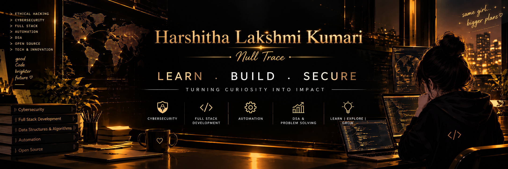

# Harshitha Lakshmi Kumari 👋

### Cybersecurity Enthusiast | Ethical Hacking Learner | Developer

B.Tech Computer Science & Engineering  
Vignan University · Class of 2028

[🌐 Portfolio](https://harshithalakshmikumari.netlify.app/) · [💻 GitHub](https://github.com/harshi329)

*Learning to build technology and make the digital world safer.*

---

## 👩‍💻 About Me

Hi! I'm Harshitha, a B.Tech Computer Science and Engineering student at Vignan University.

I'm interested in cybersecurity, ethical hacking, software development, and exploring how technology can solve real-world problems.

My journey is about learning through practice, building projects, participating in technical events, and steadily improving my programming and security skills.

- 🎓 Computer Science and Engineering student
- 🔐 Exploring cybersecurity and ethical hacking
- 🌐 Learning web development and application security
- 🧩 Practicing programming and problem-solving
- 🚀 Exploring projects, hackathons, and CTF challenges
- 🌱 Always curious to learn something new

---

## ✨ A Little About Me

- 🔍 **Curious by nature:** I enjoy exploring how technology works.
- 🛡️ **Security-minded:** I'm interested in identifying threats and understanding how systems can be protected.
- 💡 **Practical learner:** I learn by experimenting, coding, and building projects.
- 🎯 **Growth-focused:** I believe consistent practice matters more than perfection.
- 🌱 **Always improving:** Every project and challenge is an opportunity to learn.

---

## 🛠️ My Technical Skills

### Programming

### Web Development

### Tools & Platforms

### Areas I'm Exploring

- Ethical hacking fundamentals
- Phishing and scam detection
- Web and network security
- Intrusion detection concepts
- Data structures and algorithms
- Full-stack application development

---

## 🔐 My Cybersecurity Journey

Cybersecurity is one of my main interests. I'm working toward developing practical skills in understanding vulnerabilities, detecting threats, and improving application security.

My learning interests include:

- 🌐 Web application security
- 🔎 Phishing and suspicious URL detection
- 🖥️ Networking and system security
- 🐧 Linux and security tools
- 🧩 Capture The Flag challenges
- 🔬 Hands-on security labs and ethical hacking

*My goal is to build strong fundamentals and practice security only in authorized environments.*

---

## 🚀 Projects I've Explored

### 🛡️ Deepfake Shield AI

An AI-powered scam and phishing detection project concept.

**Focus areas:**
- Suspicious URL detection
- QR-code scanning
- Scam detection concepts
- Accessible security assistance

### 🖥️ SentinelShield X

An intrusion detection and web protection project focused on security monitoring and threat visualization.

**Focus areas:**
- Security dashboard design
- Threat activity visualization
- Security event monitoring
- Web protection concepts

### 🌾 Quantum-Enhanced Crop Yield Prediction

A project I worked on during Qiskit Fall Fest, exploring quantum computing for agricultural crop-yield prediction.

[🌐 View Live Project](https://quantum-enhanced-crop-yield-prediction.onrender.com/)

### 💻 CodeAlpha Projects

Projects explored during my development internship:

- Flashcard Quiz App
- Fitness Tracker App
- LinguaLearn

[Explore my repositories →](https://github.com/harshi329?tab=repositories)

---

## 🏆 Activities & Experiences

- ⚛️ Participated in Qiskit Fall Fest
- 🧩 Participated in a Capture The Flag (CTF) challenge
- 🚀 Explored technical projects and hackathon activities
- 📚 Continued learning through cybersecurity and development training

---

## 🎨 Hobbies & Interests

- 💻 Exploring technology and coding
- 🔐 Learning about cybersecurity
- 🧩 Solving programming challenges
- 🎨 Exploring UI design and creative ideas
- 🌱 Discovering new tools and technologies
- 🚀 Working on personal projects

---

## 🎯 My Current Focus

- Strengthening Python and Java fundamentals
- Improving problem-solving and DSA
- Learning ethical hacking step by step
- Understanding networking and web security
- Building practical full-stack projects
- Participating in more CTFs and hackathons

---

## 📊 GitHub Activity

---

## 📫 Connect With Me

---

### 🔐 Learn • Build • Explore • Secure

*Every commit is another step forward.*

Thanks for visiting my profile! 💛

